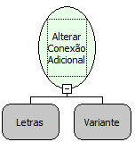

Descrição:

Altera a Conexão Adicional.

Parâmetros:

1. Nome da conexão adicional

2. Conexão que será atribuída no nome definido no 1º parâmetro. Normalmente é utilizada a função "Obter Conexão Adicional" para este parâmetro.

Retorno:

Não possui.

Nome Real:

ebfSetSubconnection

Compatibilidade:

Servidor
