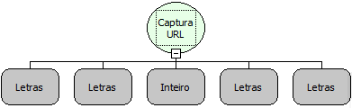

Descrição:

Obtem o conteúdo de uma URL.

Parâmetros:

1. URL (Sempre com http:// antes)

2. Proxy

3. Porta

4. Usuário (Se não existir, definir como nulo)

5. Senha (Se não existir, definir como nulo)

Retorno:

O conteúdo do URL.

Observação:

O retorno dessa função pode ser armazenado em uma variável do tipo Letras

Exemplo:

1ºParâmetro: http://www.site.com/arquivo.txt.

2ºParâmetro: 192.168.1.2,

3ºParâmetro: 8080,

4ºParâmetro: NULO,

5ºParâmetro: NULO

Retorno: Conteúdo do url http://www.site.com/arquivo.txt.

Nome Real:

ebfHttpConnection

Compatibilidade:

Servidor
