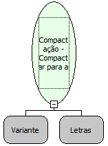

Descrição:

Compacta os arquivos para a extensão ZIP

Parâmetros:

1. Lista de arquivos/pastas para a compactação

2. Destino do arquivo compactado

Retorno:

Não possui.

Nome Real:

ebfZipFiles

Compatibilidade:

Servidor
