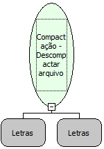

Descrição:

Descompacta os arquivos de extensão ZIP

Parâmetros:

1. Diretório de destino da descompactação

2. Diretório do arquivo ZIP para a descompactação

Retorno:

Não possui.

Nome Real:

ebfUnzipFiles

Compatibilidade:

Servidor
