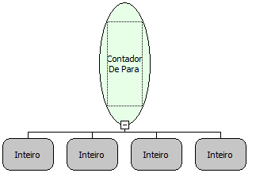

Descrição:

Executa um laço (estrutura de repetição) com o intervalo definido nos parâmetros. Enquanto a condição for satisfeita, retorna verdadeiro, quando não for, retorna falso.

Parâmetros:

1. Variável que conterá o valor corrente do laço (Inteiro).

2. Valor inicial do intervalo. Caso seja definido como Nulo, então considera-se 0.

3. Valor final do intervalo.

4. Incremento da variável. Caso não seja definido, considera-se 1.

Retorno:

Retorna Verdadeiro enquanto a condição for satisfeita ou falso, caso contrário. O resultado dessa função pode ser armazenado em uma variável do tipo lógico ou utilizado em um componente "Decisão".

Observação:

O valor inicial é atribuído à variável passada por parâmetro.

Exemplo:

Assumindo como parâmetro uma variável chamada "contador" (Inteiro), 1 (valor Inicial - Inteiro), 3 (Valor Final - 3) e 1 (incremento), enquanto contador for menor ou igual a 3, retorna verdadeiro, caso contrário, retorna falso.

Nome Real:

ebfLoop

Compatibilidade:

Servidor
