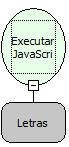

Descrição:

Executa um comando Javascript passado como parâmetro (JavaScript é uma linguagem de hiper-texto.É uma nova linguagem para  criação de Home-Pages.Funções escritas em JavaScript podem ser embutidas dentro de seu  documento HTML.).

Parâmetros:

1. Comando JavaScript.

Retorno:

Retorna o resultado do comando executado.

Exemplo:

Parâmetro: alert("Messagem a ser Enviada").

Observação:

Essa função é usada para a necessidade de executar um comando JavaScript.

Nome Real:

ebfExecuteJS

Compatibilidade:

Cliente e Servidor
