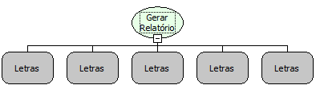

Descrição:

Gera o relatório solicitado sendo que o mesmo não será impresso na tela do usuário.

Após criado o relatório, a função retornará o caminho absoluto do arquivo gerado.

Parâmetros:

1. Nome ou código do relatório a ser gerado

2. Tipo do relatório a ser gerado.

3. Filtro a ser executado no relatório a ser gerado. Para mais de um filtro, separe com ponto e vírgula (;). (Verificar Observação)

4. Ordenação do relatório a ser gerado. Defina 1 para ascendente e 0 para descendente. Separe com pipe, vide exemplo.

5. URL do servidor (Veja OBS 2). É necessário definir a barra final. Ex.: http://192.168.0.1:8080/webrun/

Retorno:

Caminho absoluto do arquivo gerado.

Observações:

1. No caso de gerar um relatório RB10, os parâmetros devem ser utilizados no formato nome_do_parametro=valor

2. No 5º parâmetro, deverá ser informado a URL do servidor da aplicação que receberá o retorno do relatório (PDF, XLS, JPG e etc)

enviado pelo ReportServer (Servidor de relatório 2.6).

Exemplo:

Parâmetro 1: Relatório de Teste

Parâmetro 2: PDF, HTM, SCR (Tela), TXT, XLS, RTF

Parâmetro 3: CIDADE.NOME=Salvador;CIDADE.UF=BA (RB7) | cidade=Salvador;estado=BA

Parâmetro 4: CIDADE.NOME|0;CIDADE.UF|1
