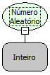

Descrição:

Retorna um número inteiro aleatório entre 0 e o valor informado como parâmetro.

Parâmetros:

1. Valor que definirá o intervalo do número.

Retorno:

Número aleatório (Inteiro).

Exemplo:

Assumindo como parâmetro 7 (Inteiro), o retorno seria um número aleatório entre 0 e 7.

Nome Real:

ebfRandom

Compatibilidade:

Cliente e Servidor
