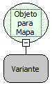

Descrição:

Converte as propriedades do objeto passado para um Mapa.

Parâmetros:

1. Objeto a ser convertido

Retorno:

Retorna um Mapa contendo as propriedades do objeto

Observação:

Os nomes das propriedades são convertidas para letras maiúsculas.

Nome Real:

ebfObjectToMap

Compatibilidade:

Servidor
