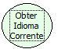

Descrição:

Obtém o idioma que está sendo utilizado no momento.

Parâmetros:

Não possui

Retorno:

Retorna o idioma da aplicação.

Exemplo:

Caso o idioma corrente que esteja sendo utilizado for o inglês, então a função retornará o valor: "en_US"

Nome Real:

ebfCurrentLanguage

Compatibilidade:

Cliente e Servidor
