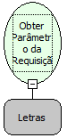

Descrição:

Obtém um parâmetro da requisição.

Parâmetros:

1. Nome do parâmetro na requisição

Retorno:

Retorna o valor do parâmetro definido na requisição ou Nulo caso o mesmo não exista.

Observação:

Esta função deve ser utilizada no evento "Ao Entrar".

Exemplos:

Caso o parâmetro seja "sys", então o retorno será a sigla do sistema.

Caso o parâmetro seja "formID", então o retorno será o ID do formulário.

Nome Real:

ebfRequestGetParameter

Compatibilidade:

Servidor
