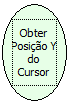

Descrição:

Obtém a posição vertical (relativa ao formulário atual) do cursor.

Parâmetros:

Não possui.

Retorno:

Posição Y do Cursor (Inteiro).

Nome Real:

ebfGetCursorY

Compatibilidade:

Cliente
