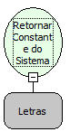

Descrição:

Função para retornar uma constante do sistema.

Parâmetros:

1. Nome da constante do sistema.

Retorno:

Não possui.

Observação:

Para mais informações, consulte o manual do sistema no item Formulário &gt; Definições que contém todas as contantes disponíveis. (Devem ser colocadas os nomes das funções, e não a chamada dela. Exemplo Abaixo.). Algumas constantes: data, datahora, usuario, login, hora, horasimples, guid, rand2, rand3, administrador, rand4, rand5, rand6, sistema, sistemanome, ip, host, database:&lt;propriedade&gt;, sistema:&lt;grupo&gt;:&lt;chave&gt;, propriedades:&lt;chave&gt;, avancadas:&lt;chave&gt;.

Nome Real:

ebfGetSystemConstant

Compatibilidade:

Servidor
