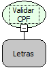

Descrição:

Verifica se um valor é um CPF. Caso o valor seja vazio, será considerado que o CPF é válido.

Parâmetros:

1. Valor a ser avaliado.

Retorno:

Retorna Verdadeiro se for um CPF, caso contrário retorna Falso.

Nome Real:

ebfCPFValidation

Compatibilidade:

Cliente e Servidor
