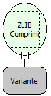

Descrição:

Comprime um conjunto de dados (Texto, Imagem...) utilizando o algoritimo ZLIB definido pela RFC 1950 ZLIB Compressed Data Format Specification version 3.3 (www.ietf.org/rfc/rfc1950.txt). (Zlib é uma biblioteca genérica  de compactação e descompactação).

Parâmetros:

1. Array de Bytes

Retorno:

Array de Bytes comprimido.

Exemplo:

1° Parâmetro: Campo BLOB

Observações:

1. BLOB (Binary Large Object) é normalmente usado para imagens

2. Essa função é usada para abrir comprimir Arrray de Bytes

Nome Real:

ebfZLIBDeflate

Compatibilidade:

Servidor
