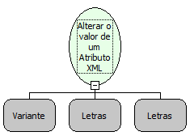

Descrição:

Essa função altera um valor de um Atributo em um documento XML (Existem dois tipos de informação que podem aparecer em um documento XML: elementos e atributos). Elementos são as informações que são representadas entre as tags e atributos são informações adicionais que são acrescentadas a uma tag)

Parâmetros:

1. Objeto XML

2. Atributo

3. Valor a ser modificado

Observações:

A linguagem XML é definida como o formato universal para dados estruturados na Web. Para saber mais sobre o assunto, pesquise em um site de busca sobre (XML) ou (Extensible Markup Language).

Exemplos:

Se o Elemento é ?Maker Complemento=?MakerFlow?? e o Atributo é ?Complemento=?MakerFlow? ?, então o valor do atributo é ).

Nome Real:

ebfXMLSetElementAttributeValue

Compatibilidade:

Servidor
