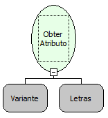

Descrição:

Obtém o atributo do Elemento XML informado (Atributos são informações adicionais que são acrescentadas a uma tag(delimitadores)).

Parâmetros:

1. Objeto XML.

2. Nome do Atributo.

Retorno:

A variável de Retorno deverá ser do tipo Variante

Observação:

A linguagem XML é definida como o formato universal para dados estruturados na Web. Para saber mais sobre o assunto, pesquise em um site de busca sobre (XML) ou (Extensible Markup Language).

Exemplo:

Se tivermos então um elemento XML . Janice Jefferson Lembre-se Lançamento do oficial do Maker Então retorna: 3.0.

Nome Real:

ebfXMLGetAttribute

Compatibilidade:

Cliente e Servidor
