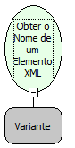

Descrição:

Obtém o nome de um elemento XML.

Parâmetros:

1. Objeto XML.

Retorno:

Letras

Exemplos:

Se temos então

        &lt;TEXTO&gt;

Maker Flow  Versão = 3.0

         &lt;/TEXTO&gt;

    O retorno será: TEXTO

Nome Real:

ebfXMLGetElementTagName

Compatibilidade:

Cliente e Servidor
