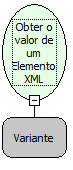

Descrição:

Obtém todo o conteúdo e  todos os sub-elementos que estão dentro do Elemento.

Parâmetros:

1. Objeto XML (nó do elemento)

Exemplo:

Se temos  então

    &lt;TEXTO&gt;

            Maker Flow

            &lt;SQL&gt;Sequel&lt;/SQL&gt;

            &lt;MAKER&gt;Flow&lt;/MAKER&gt;

    &lt;/TEXTO&gt;

    Então o retorno seria: Maker Flow , &lt;SQL&gt;Sequel&lt;/SQL&gt; e &lt;MAKER&gt;Flow&lt;/MAKER&gt;

Nome Real:

ebfXMLGetElementValue

Compatibilidade:

Cliente e Servidor
