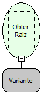

Descrição:

Obtém um elemento raiz de um XML.(O Elemento raiz seria o elemento pai de um arquivo XML)

Parâmetros:

1. Objeto XML

Retorno:

 A variável de Retorno deverá ser do tipo Variante

Observação:

A linguagem XML é definida como o formato universal para dados estruturados na Web. Para saber mais sobre o assunto, pesquise em um site de busca sobre (XML) ou (Extensible Markup Language).

Exemplo:

Se tivermos então um elemento XML .

      &lt;?xml version="1.0" encoding="ISO-8859-1"?&gt;

      &lt;software&gt;

        &lt;titulo&gt;Maker&lt;/titulo&gt;

        &lt;direitos&gt;SOFTWELL&lt;/direitos&gt;

        &lt;ano&gt;2007&lt;/ano&gt;

      &lt;/software &gt;

    Então retorna: &lt; software &gt;.

Nome Real:

ebfXMLGetRoot

Compatibilidade:

Cliente e Servidor
