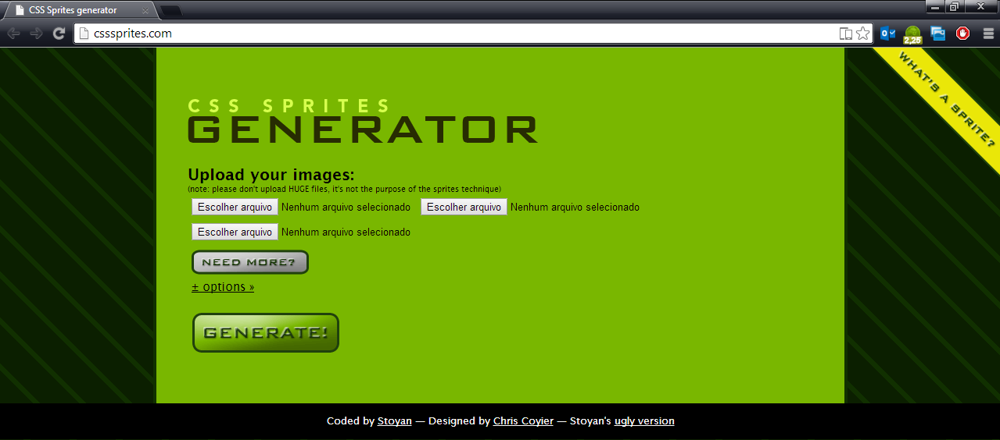
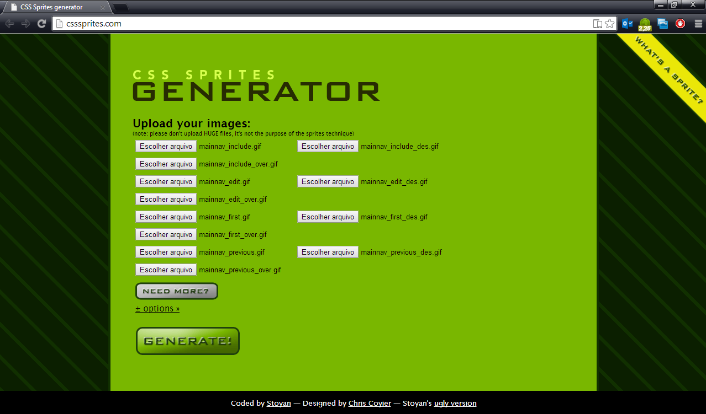
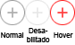
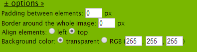
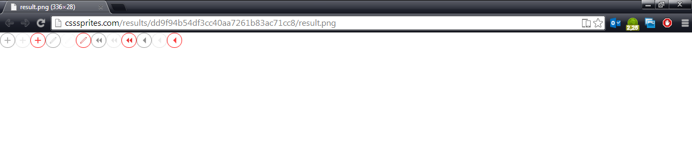

A versão 3.5 otimiza as requisições ao servidor, desta forma, até conexões mais lentas poderão acessar os sistemas desenvolvidos em Maker como se tivessem banda larga.

Devido à nova implementação do Webrun, que visa a aumentar a performance do sistema, foi reduzido o número de requisições de imagens que é feita no carregamento do sistema, o que torna a abertura e navegação de formulários muito mais rápido.
Para isto foi necessário à criação de uma imagem que contém todas as imagens da barra de navegação, todos os skins já foram preparados para isto, mas visando não interferir na possibilidade personalização dos sistemas, disponibilizamos este tutorial que explica passo-a-passo para a criação da nova barra de navegação.

1. Inicialmente será necessário acessar ao site: [CSS Sprite](http://csssprites.com/)

2. Nele você encontrará a possibilidade fazer o upload das imagens da barra de navegação e clicando em “Need More?” para adicionar mais imagens.

3. É necessário seguir uma ordem e algumas configurações especificas. Sempre o botão normal, depois o desabilitado e por último o do hover (ao passar o mouse).

Exemplo:

**Ordem dos ícones:**

- Adicionar;
- Editar;
- Primeiro;
- Anterior;
- Próximo;
- Último;
- Excluir;
- Atualizar;
- Imprimir;
- Log;
- Valores Padrão;
- Ajuda;
- Sair.

Obs.: Caso não utilize uma das imagens, adicione uma imagem qualquer no lugar, do mesmo tamanho, pois a falta de algum ícone causará uma quebra na exibição dos ícones.

4. Clique em **“+options”** coloque da maneira como apresentada na imagem abaixo:

5. Clicar no botão **“GENERATE!”** para que as imagens sejam geradas, após isto, clicar no botão **“DOWNLOAD SPRITE PNG”**, onde será aberto uma nova janela com a imagem gerada em “.PNG”, com algum programa de edição de imagem, converta-a para “.GIF” e renomeie o arquivo para navIcons.gif.

6. Ao terminar coloque o arquivo convertido (navIcons.gif) na pasta do Webrun em:
   ..\Skins\Skin utilizado\HTMLNavigationForm

7. Limpe o cache do navegador e atualize a página para que a alteração seja bem sucedida.

**IMPORTANTE:**

Ocorreram mudanças no arquivo Classe.css, então caso você tenha efetuado alguma mudança e não queira perder, será necessário incluir este trecho (clique aqui), no seu arquivo que se encontra na pasta “Skins\Skin utilizado". Os tamanhos das imagens podem variar de skin para skin, o que pode ocasionar um deslocamento da imagem no formulário, para corrigir isto, é necessário fazer alterações diretas no CSS, buscar por /*Botões da Barra de Navegação*/ onde tiver a propriedade background-position, vá modificando os pixels para mais ou para menos para ajustar o ícone na tela corretamente. Exemplo: background-position: -84px. Lembrando que também é necessário que todas as imagens sejam do mesmo tamanho.
