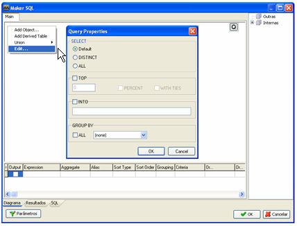
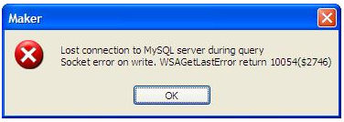

# MySQL Server 5/ 5.1 / 5.5

O Maker suporta bancos MySQL Server 5 com a engine **InnoDB** com algumas restrições:

- O campo do tipo YEAR não é suportado, quando o projeto está em modo de execução pelo Webrun.
- A função LIMIT (opção Limitar registros, tela Construtor de Consultas) não funciona no Gerador de Relatórios:

- Caso haja algum problema com a definição de Apelido para campos na aba Localizar (campos de pesquisa ou campos para a grade), será preciso utilizar a função CAST. Observe o exemplo abaixo:

Select fr_acaoparametro.aco_codigo,

Cast(fr_acao.aco_nome As Char) As 'r;Nome da Ação"

From

fr_acaoparametro Inner Join

fr_acao On fr_acaoparametro.aco_codigo = fr_acao.aco_codigo

Observações:

1. A função CAST é aplicada na coluna Expressão do Assistente SQL. Para um bom funcionamento da função no Maker, é necessário criar colocar um Apelido;
2. Os campos-chave que tenham Sequences associados a eles não podem ser obrigatórios.

## Erro ao tentar gravar imagens

Alguns fluxos, relatórios ou formulários podem eventualmente exceder o tamanho máximo do BLOB que vem configurado por padrão no MySQL, demonstrando o seguinte erro:

Erro: Lost connection to MYSQL server during query socket error on write. WSAGetLastError return 1004($2746)

Para corrigir, defina um novo tamanho máximo para pacotes de dados no servidor através das seguintes opções:

Primeira opção - por meio da linha de comando de inicialização do servidor:

shell&gt;mysql--max_allowed_packed=16M

Segunda opção - por meio da adição de um parâmetro no INI de configuração do servidor:

[mysqld]

max_allowed_packet=16M

ou

[mysqld]

set-variable = max_allowed_packet=10240000

## Autoincremento no Webrun

O Webrun não reconhece o campo autoincremento no momento da gravação de um registro. Para que o campo seja reconhecido, o desenvolvedor deve definir o campo-chave como apenas leitura e retirar a obrigatoriedade em "[Campos Obrigatórios](../../maker_3/formulario/barra_de_ferramentas_da_tela)"
