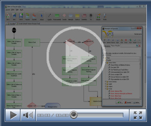

[
Abrir url na moldura](ftp://ftp.softwell.com.br/videos/abrir_url_na_moldura.zip)

Esse vídeo exemplifica o uso da função Abrir Url numa Moldura de um formulário.

(Duração 1'46'', Tamanho 4,17 Mb)

[Criando Funções](ftp://ftp.softwell.com.br/videos/criando_funcoes.zip)

Este vídeo demonstra os passos para a criação de uma nova função para o Editor de fluxos de Ações.

(Duração 3'22'', Tamanho 5,14 Mb)

[Exemplificando a função CANCELPOST](ftp://ftp.softwell.com.br/videos/exemplificando_a_funcao_canselpost.zip)

É uma expressão onde a ação/execução é cancelada, ou seja, não é executada a operação.

(Duração 1'23'', Tamanho 3,24 Mb)

[Utilizando a Função Abrir Leitor Digital](ftp://ftp.softwell.com.br/videos/leitor_digital.zip)

Esta vídeo aula demonstra de forma prática o uso da função Abrir Leitor Digital.

(Duração manipulada pelo usuário, Tamanho 2,14Mb)

[Utilizando a Função Array para Lista](ftp://ftp.softwell.com.br/videos/funcao_array_para_lista.zip)

Este vídeo exemplifica o uso da Função Array para Lista.

(Duração 01'13", Tamanho 2.00 Mb)

[Utilizando a Função Árvore - Filtrar Árvore](ftp://ftp.softwell.com.br/videos/filtrar arvore.zip)

Este vídeo exemplifica o uso da Função Árvore - Filtrar Árvore.

(Duração 02' 00", Tamanho 3,05 Mb)

[Utilizando a Função Alterar Máscara](ftp://ftp.softwell.com.br/videos/alterar_mascara.zip)

Este vídeo exemplifica o uso da Função Alterar Máscara

(Duração 2' 10", Tamanho 3,26 Mb)

[Utilizando a Função Campo](ftp://ftp.softwell.com.br/videos/obtendo_pasta_no_repositorio_de_email.zip)

Esta videoaula exemplifica a utilização da Função Campo.

(Duração 1'29'', Tamanho 4,23 Mb)

[Utilizando a Função Cor para RGB](ftp://ftp.softwell.com.br/videos/cor_para_rgb.zip)

Esta videoaula exemplifica a utilização da Função Cor para RGB

(Duração manipulada pelo usuário, Tamanho 2,11 Mb)

[Utilizando a Função Criar Data](ftp://ftp.softwell.com.br/videos/criar_data.zip)

Esta videoaula exemplifica a utilização da Função Criar Data

(Duração manipulada pelo usuário, Tamanho 3,60 Mb)

[Utilizando a Função Dia da semana](ftp://ftp.softwell.com.br/videos/dia_da_semana.zip)

Esta videoaula exemplifica a utilização da Função Dia da semana.

(Duração manipulada pelo usuário, Tamanho 2,00 Mb)

[Utilizando a Função Email-Repositório de emails](ftp://ftp.softwell.com.br/videos/obtendo_pasta_no_repositorio_de_email.zip)

Esta videoaula exemplifica a utilização da Função Email-Repositório de emails.

(Duração 1'21", Tamanho  2,89 Mb)

[Utilizando a Função é nulo ou vazio](ftp://ftp.softwell.com.br/videos/e_nulo_ou_vazio.zip)

Esta videoaula exemplifica a utilização da Função é nulo ou vazio.

(Duração manipulada pelo usuário, Tamanho 2,73 Mb)

[Utilizando a Função Formatação](ftp://ftp.softwell.com.br/videos/formatacao.zip)

Esta videoaula exemplifica a utilização da Função Formatação.

(Duração manipulada pelo usuário, Tamanho 2,17 Mb)

[Utilizando a Função FTP - Abrir conexão FTP](ftp://ftp.softwell.com.br/videos/abrir_conexao_ftp.zip)

Esta videoaula exemplifica como abrir uma conexão FTP.

(Duração manipulada pelo usuário, Tamanho 2,30 Mb)

[Utilizando a Função FTP - Adicionar arquivo ao servidor FTP](ftp://ftp.softwell.com.br/videos/ftp_adicionar_arquivo_ao_servidor_ftp.zip)

Esta videoaula exemplifica o uso da Função FTP - Adicionar Arquivo ao servidor FTP.

(Duração manipulada pelo usuário, Tamanho 1,76 Mb)

[Utilizando a Função FTP - Criar um diretório](ftp://ftp.softwell.com.br/videos/ftp_criar_um_diretorio.zip)

Esta videoaula exemplifica o uso da função FTP - Criar um diretório.

(Duração manipulada pelo usuário, Tamanho 2,34 Mb)

[Utilizando a Função FTP - Deletar um arquivo](ftp://ftp.softwell.com.br/videos/ftp_ deletar_um_arquivo.zip)

Esta videoaula exemplifica a utilização da Função FTP- Deletar um arquivo.

(Duração manipulada pelo usuário, Tamanho 2,00 Mb)

[Utilizando a Função FTP - Deletar um diretório](ftp://ftp.softwell.com.br/videos/ftp_ deletar_diretorio.zip)

Esta videoaula exemplifica o uso da função FTP Deletar um diretório.

(Duração manipulada pelo usuário, Tamanho 2,12 Mb)

[Utilizando a Função FTP - Executar comando FTP](ftp://ftp.softwell.com.br/videos/ftp_executar_comando_ftp.zip)

Esta videoaula exemplifica o uso da função FTP - Executar comando FTP.

(Duração manipulada pelo usuário, Tamanho 2,27 Mb)

[Utilizando a Função FTP - Fechar Conexão FTP](ftp://ftp.softwell.com.br/videos/fechar_conexao_ftp.zip)

Esta videoaula exemplifica o uso da função FTP - Fechar Conexão FTP.

(Duração manipulada pelo usuário, Tamanho 2,16 Mb)

[Utilizando a função FTP - Listar o conteúdo de uma pasta](ftp://ftp.softwell.com.br/videos/listar_o_conteudo_de_uma_pasta.zip)

Esta videoaula exemplifica o uso da função FTP - Listar o conteúdo de uma pasta.

(Duração manipulada pelo usuário, Tamanho 1,83 Mb)

[Utilizando a Função FTP Listar o conteúdo de uma pasta informada](ftp://ftp.softwell.com.br/videos/ftp_listar_conteudo_da_pasta_informada.zip)

Esta videoaula exemplifica o uso da função FTP - Listar o conteúdo de uma pasta informada.

(Duração manipulada pelo usuário, Tamanho 2,12 Mb)

[Utilizando a Função FTP - Modo Passivo](ftp://ftp.softwell.com.br/videos/ftp_modo_passivo.zip)

Esta videoaula exemplifica o uso da função FTP - Modo Passivo

(Duração manipulada pelo usuário, Tamanho 2,30 Mb)

[Utilizando a função FTP - Mostrar diretório de trabalho corrente](ftp://ftp.softwell.com.br/videos/mostra_diretorio_de_trabalho_corrente.zip)

Esta videoaula exemplifica o uso da função FTP - Mostrar área de trabalho corrente.

(Duração manipulada pelo usuário, Tamanho 1,89 Mb)

[Utilizando a Função FTP - Nível acima](ftp://ftp.softwell.com.br/videos/ftp_nivel_acima.zip)

Esta videoaula exemplifica o uso da função FTP - Nível acima.

(Duração manipulada pelo usuário,Tamanho 1,75 Mb)

[Utilizando a Função FTP - Obter arquivo do servidor FTP](ftp://ftp.softwell.com.br/videos/ftp_obter_arquivo_do_servidor_ftp.zip)

Esta videoaula exemplifica o uso da função FTP - Obter arquivo do servidor FTP.

(Duração manipulada pelo usuário, Tamanho 1,76 Mb)

[Utilizando a Função FTP - Trocar a pasta atual](ftp://ftp.softwell.com.br/videos/ftp_trocar_a_pasta_atual.zip)

Esta videoaula exemplifica o uso da função FTP - Trocar a pasta atual.

(Duração manipulada pelo usuário, Tamanho 2.00 Mb)

[Utilizando a Função Hexadecimal](ftp://ftp.softwell.com.br/videos/hexadecimal.zip)

Esta vídeo aulaexemplifica a utilização da Função Hexadecimal.

(Duração manipulada pelo usuário, Tamanho 2,44 Mb)

[Utilizando a Função Hexadecimal para inteiro](ftp://ftp.softwell.com.br/videos/hexadecimal_para_inteiro.zip)

Esta videoaula exemplifica como converter valores hexadecimais para inteiros.

(Duração manipulada pelo usuário, Tamanho 2,66 Mb)

[Utilizando a Função Hoje](ftp://ftp.softwell.com.br/videos/hoje.zip)

Esta videoaula exemplifica como obter a data atual.

(Duração manipulada pelo usuário, Tamanho 1,91 Mb)

[Utilizando a Função Milisegundos](ftp://ftp.softwell.com.br/videos/milisegundos.zip)

Esta vídeoaula exemplifica como obter os milisegundos de 1970 até a data atual.

(Duração manipulada pelo usuário, Tamanho 1,93 Mb)

[Utilizando a Função Nanosegundos](ftp://ftp.softwell.com.br/videos/nanosegundos.zip)

Esta videoaula exemplifica como obter os nanosegundos da hora total.

(Duração manipulada pelo usuário, Tamanho1,92 Mb)

[Utilizando a Função Obtém Hora completa](ftp://ftp.softwell.com.br/videos/obtem_hora_completa.zip)

Esta videoaula exemplifica obter a hora completa.

(Duração manipulada pelo usuário, Tamanho 2,09 Mb)

[Utilizando a Função Obtém Milisegundos da data](ftp://ftp.softwell.com.br/videos/milisegundos_da_data_desde_1970.zip)

Esta videoaula exemplifica como obter os milisegundos de data desde 1970.

(Duração manipulada pelo usuário, Tamanho 2,00 Mb)

[Utilizando a Função Obter Janela do Formulário.](ftp://ftp.softwell.com.br/videos/obtem_janela_do_formulario.zip)

Esta videoaula exemplifica a utilização da função Obter Janela do Formulário.

(Duração manipulada pelo usuário, Tamanho 2' 05" Mb)

[Utilizando a Função Para Código ASCII](ftp://ftp.softwell.com.br/videos/funcao_para_ascii.zip)

Esta videoaula exemplifica o uso da função Para Código ASCII.

(Duração manipulada pelo usuário, Tamanho 2,03 Mb)

[Utilizando a Função Para Data](ftp://ftp.softwell.com.br/videos/utilizando_a_funcao_para_data.zip)

Esta videoaula exemplifica o uso da Função para Data.

(Duração manipulada pelo usuário, Tamanho 2,32 Mb)

[Utilizando a Função Para Depuração](ftp://ftp.softwell.com.br/videos/ponto_de_parada_funcao_soma_.zip)

Esta videoaula exemplifica o uso da Função Para Depuração.

(Duração 1'42", Tamanho 3,58 Mb)

[Utilizando a Função Para Extenso](ftp://ftp.softwell.com.br/videos/para_extenso.zip)

Esta videoaula exemplifica o uso da Função Para Extenso.

(Duração manipulada pelo usuário, Tamanho 2,33 Mb)

[Utilizando a Função Para Fracionado](ftp://ftp.softwell.com.br/videos/funcao_para_fracionado.zip)

Esta videoaula exemplifica o uso da função Para Fracionado.

(Duração manipulada pelo usuário, Tamanho 1,96 Mb)

[Utilizando a Função Para Inteiro](ftp://ftp.softwell.com.br/videos/funcao_para_inteiro.zip)

Esta videoaula exemplifica o uso da função Para Inteiro.

(Duração manipulada pelo usuário, Tamanho 1,94 Mb)

[Utilizando a Função Para Letras(JS)](ftp://ftp.softwell.com.br/videos/funcao_para_letras(JS).zip)

Esta videoaula demonstra o uso da função Para Letras(JS).

(Duração manipulada pelo usuário, Tamanho 2,05 Mb)

[Utilizando a Função Para Lógico](ftp://ftp.softwell.com.br/videos/para_logico.zip)

Esta videoaula demonstra o uso da Função Para Lógico.

(Duração 16", Tamanho 4,40 Mb)

[Utilizando a Função Remover Acentos](ftp://ftp.softwell.com.br/videos/remover_acentos_.zip)

Esta vídeoaula demonstra o uso da Função Remover Acentos.

(Duração Manipulada pelo usuário, 4,00 Mb)

[Utilizando a Função Definir Permissões de Menu](ftp://ftp.softwell.com.br/videos/permissao_menu.zip)

Esta videoaula demonstra o uso da Função Permissão de Menu.

(Duração 32" Tamanho 3,83 Mb)

[Utilizando a Função Tabela para lista](ftp://ftp.softwell.com.br/videos/funcao_tabela_para_lista.zip)

Esta videoaula demonstra o uso da função Tabela para Lista

(Duração manipulada pelo usuário, Tamanho 2,16 Mb)

[Utilizando a Função Texto Binário para Texto](ftp://ftp.softwell.com.br/videos/texto_para_binario.zip)

Esta videoaula demonstra o uso da Função Texto Binário para Texto.

(Duração manipulada pelo usuário, Tamanho 3,00 Mb)

[Utilizando a Função Texto para base 64](ftp://ftp.softwell.com.br/videos/base_64.zip)

Esta videoaula demonstra o uso da Função Texto para base 64.

(Duração manipulada pelo usuário, Tamanho 2,00 Mb)

[Utilizando a Função Texto para HTML](ftp://ftp.softwell.com.br/videos/funcao_texto_para_html.zip)

Esta videoaula demonstra como converter um texto normal para HTML utilizando a função Texto para HTML.

(Duração manipulada pelo usuário, Tamanho 2,44 Mb)

[Utilizando as Funções Definir Cookie e Obter o valor de um Cookie](ftp://ftp.softwell.com.br/videos/definir cookie e obter valor do cookie.zip)

Esta video aula demonstra a utilização das funções Definir Cookie e Obter valor de um Cookie.

(Duração manipulada pelo usuário, Tamanho 3.54 Mb)

[Utilizando as funções: Lista Dupla - Obter seleções lista selecionados e Lista Dupla - Obter seleções lista principal.](ftp://ftp.softwell.com.br/videos/funcoes_lista_dupla_novo.zip)

Esta videoaula demonstra a utilização das funções Lista dupla - Obter seleções lista selecionados e Lista Dupla Obter seleções lista Principal.

(Duração manipulada pelo usuário, Tamanho 2,58 mb)

[Utilizando as Funções Para Graus e Para Radianos](ftp://ftp.softwell.com.br/videos/conversor_radianos_e_graus.zip)

Esta videoaula demonstra o uso das Funções Para Graus e Para Radianos.

(Duração manipulada pelo usuário, Tamanho 2,29 Mb)

[Utilizando função XML](ftp://ftp.softwell.com.br/videos/utilizando_funcao_xml.zip)

Este exemplo demonstra a utilização de funções da Categoria XML.

(Duração manipulada pelo usuário, Tamanho 4,39 Mb)

[Utilizando Funções: Associar Evento ao Componente e Remover Evento Associado](ftp://ftp.softwell.com.br/videos/associar_evento_e_remover_evento_do_componente.zip)

Este exemplo demonstra a utilização das funções: Associar Evento ao Componente e Remover Evento Associado.

(Duração manipulada pelo usuário, Tamanho 3,85 Mb)

[Utilizando Funções da Categoria Arquivo](ftp://ftp.softwell.com.br/videos/arquivo_2.zip)

Este exemplo demonstra a utilização de funções da Categoria Arquivo (Pode Ler?, Abrir arquivo para leitura, Ler todo Arquivo e Renomear Arquivo)

(Duração manipulada pelo usuário, Tamanho 3,47 Mb)

[Utilizando Funções da Categoria Arquivo(2)](ftp://ftp.softwell.com.br/videos/Arquivo(1).zip)

Este exemplo demonstra a utilização de funções da categoria Arquivo (Criar Novo Arquivo, Existe o Arquivo?, Abrir arquivo para escrita, Adicionar a arquivo, Percorrer Diretório, Obter pai do Arquivo, Remover Arquivo e Mover Arquivo)

(Duração manipulada pelo usuário, Tamanho 3,28 Mb)

[Utilizando Funções da Categoria Banco de Dados](ftp://ftp.softwell.com.br/videos/funcoes_da_categoria_banco_de_dados.zip)

Este exemplo demonstra a utilização de funções da categoria Banco de Dados

(Duração manipulada pelo usuário, Tamanho 2,37 Mb)

[Utilizando Funções da Categoria Banco de Dados (2)](ftp://ftp.softwell.com.br/videos/funcoes_banco_de_dados_2.zip)

Este exemplo demonstra a utilização de funções da categoria Banco de Dados

(Duração manipulada pelo usuário, Tamanho 2,38 Mb)

[Utilizando Funções da Categoria Desenho](ftp://ftp.softwell.com.br/videos/desenho.zip)

Este exemplo demonstra a utilização de funções da Categoria Desenho.

(Duração manipulada pelo usuário, Tamanho 3,30 Mb)

[Utilizando Funções da Categoria Email](ftp://ftp.softwell.com.br/videos/email_funcoes.zip)

Este exemplo demonstra a utilização de funções da Categoria Email.

(Duração manipulada pelo usuário, Tamanho 3,95 Mb)

[Utilizando Funções da Categoria Email( Email - Texto da mensagem)](ftp://ftp.softwell.com.br/videos/email_obter_texto_da_mensagem.zip)

Este exemplo demonstra a utilização da função Email - Texto da mensagem.

(Duração manipulada pelo usuário, Tamanho 2,48 Mb)

[Utilizando Funções da Categoria Mapeamento](ftp://ftp.softwell.com.br/videos/categoria_mapa_.zip)

Este exemplo demonstra a utilização das funções da categoria Mapeamento.

(Duração manipulada pelo usuário, Tamanho 2,46 Mb)

[Utilizando Funções da Categoria Matématica(Arco)](ftp://ftp.softwell.com.br/videos/matematica_arco.zip)

Este exemplo demonstra a utilização das seguintes funções: Arco seno, Arco cosseno e Arco tangente.

(Duração manipulada pelo usuário, Tamanho 2,54Mb)

[Utilizando Funções:Diferença de Anos , Diferença de meses e Diferença de dias](ftp://ftp.softwell.com.br/videos/primeiro_dia_do_mes_ultimo_dia_do_mes.zip)

Este exemplo demonstra  a utilização das funções:Diferença de Anos,Diferença de meses e Diferença de dias

(Duração manipulada pelo usuário, Tamanho 3,44 Mb)

[Utilizando Funções : Hora, minuto e Segundo](ftp://ftp.softwell.com.br/videos/hora_minuto_segundo.zip)

Este exemplo demonstra a utilização das funções:Hora,minuto e segundo.

(Duração manipulada pelo usuário, Tamanho 2,22 Mb)

[Utilizando Funções: Incrementa Ano, Incrementa mês e Incrementa Dia](ftp://ftp.softwell.com.br/videos/incrementa_dia_mes_ano.zip)

Este exemplo demonstra a utilização das Funções: Incrementa Ano, Incrementa mês e Incrementa Dia.

(Duração manipulada pelo usuário, Tamanho 6,43 Mb)

[Utilizando Funções: Primeiro Dia do mês e Ultimo dia do mês](ftp://ftp.softwell.com.br/videos/primeiro_dia_do_mes_ultimo_dia_do_mes.zip)

Este exemplo demonstra a utilização das Funções: Primeiro Dia do mês e Último dia do mês.

(Duração manipulada pelo usuário, Tamanho 3,50 Mb)

[Utilizando Funções SQL(Divisão)](ftp://ftp.softwell.com.br/videos/executar_atualizacao_divisao.zip)

Este exemplo demonstra a utilização da função Divisão da caregoria SQL.

(Duração 2' 45", Tamanho 3,86 Mb)

[Utilizando Funções SQL(Multiplicação)](ftp://ftp.softwell.com.br/videos/funcoes_sql_multiplicacao.zip)

Este exemplo demonstra a utilização da Função Multiplicação da categoria SQL.

(Duração 2'17", Tamanho 3,86 Mb)

[Utilizando Funções SQL(Subtração)](ftp://ftp.softwell.com.br/videos/funcoes_sql_subtracao_.zip)

Este exemplo demonstra a utilização da Função Subtração da categoria SQL.

(Duração 2''17", Tamanho 4,00 Mb)

[Utilizando Funções SQL(Soma)](ftp://ftp.softwell.com.br/videos/somatorio_funcao_soma.zip)

Este exemplo demonstra a utilização da Função Soma da categoria SQL.

(Duração 2"17', Tamanho 3,98 Mb)
