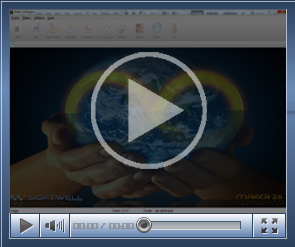

# Vídeo Aula - Maker

[Acessando Formulários externamente](ftp://ftp.softwell.com.br/videos/formulario_externo.zip)

Este vídeo demonstra como acessar um formulário, por meio externo

(Duração 02'33", Tamanho 3,95 Mb)

[Adicionando uma Sub-Consulta](ftp://ftp.softwell.com.br/videos/adicionando_uma_sub_consulta.zip)

Este exemplo apresenta o recurso de criação de subconsultas no Assistente SQL.

(Duração 1'04'', Tamanho 2,18 Mb)

[Adicionando um objeto a consulta](ftp://ftp.softwell.com.br/videos/adicionando_um_objeto_a_consulta.zip)

Este exemplo demonstra como adicionar um objeto à consulta SQL

(Duração 1'04'', Tamanho 2,12 Mb)

[Adicionando Usuário ao Grupo](ftp://ftp.softwell.com.br/videos/adicionar_usuario_ao_grupo.zip)

Esse exemplo demonstra como adicionar um usuário a um determinado grupo

(Duração 2'12", Tamanho 4,70 Mb)

[Adicionando Applet numa Moldura](ftp://ftp.softwell.com.br/videos/applet_numa_moldura.zip)

Esse exemplo demonstra como abrir um Applet no componente Moldura

(Duração 1'50", Tamanho 3,50 Mb)

[Agendar Fluxo](ftp://ftp.softwell.com.br/videos/agendar_fluxo.zip)

Este vídeo exemplificará a utilização da função Agendar Execução de Fluxo, definindo o momento de execução de um fluxo de ações.

(Duração 31'', Tamanho 3,8 Mb)

[Alterando imagem dos ícones do componente Árvore](ftp://ftp.softwell.com.br/videos/alterando_imagens_dos_icones_da_arvore.zip)

Essa vídeo aula demonstra que é possível alterar as imagens dos ícones do componente Árvore

(Duração 01'48", Tamanho 4,11 Mb)

[Alterando valor de um componente imagem sem vínculo com o banco](ftp://ftp.softwell.com.br/videos/alterando_o_valor_do_componente_imagem_sem_vinculo_ao_banco.zip)

Essa vídeo aula demonstra que é possível alterar o valor de um componente Imagem, sendo que e a mesma não esteja vinculada com o banco.

(Duração manipulada pelo usuário)

[Alterando valor do componente em outro formulário](ftp://ftp.softwell.com.br/videos/alterando_valor_do_componente_em_outro_formulario.zip)

Este vídeo exemplifica um formulário manipulando o conteúdo de um componente de um outro formulário.

(Duração 01'48'', Tamanho 3,92 Mb)

[Assistente de Criação de Tabela](ftp://ftp.softwell.com.br/videos/assistente_de_criacao_de_tabela.zip)

Este vídeo exemplifica o Assistente de Criação de Tabelas no banco de dados, ao criar um novo formulário sem fonte de dados.

(Duração 13'', Tamanho 5,16 Mb)

[Configurações do Sistema](ftp://ftp.softwell.com.br/videos/configuracoes_do_sistema.zip)

Este vídeo demonstra como verificar as configurações básicas no Maker para conectar com o banco de dados do projeto.

(Duração 1'26'', Tamanho 3,03 Mb)

[Controle de Acesso Grupo e Usuário](ftp://ftp.softwell.com.br/videos/controle_de_acesso_grupo_e_usuario.zip)

Este vídeo demonstra a criação de grupos e usuários para acessar o Maker e desenvolver projetos.

(Duração 1'10'', Tamanho 3,90 Mb)

[Cor Condicional da Grade por fluxo](ftp://ftp.softwell.com.br/videos/cor_condicional_da_grade_por_fluxo.zip)

Esse exemplo demonstra como utilizar a Propriedade Cor Condicional personalizada por fluxo.

(Duração 1'37'', Tamanho 4,5 Mb)

[Criação de Formularios](ftp://ftp.softwell.com.br/videos/criacao_de_formularios.zip)

Este vídeo demonstra a criação de formulários por assistente.

(Duração 27'', Tamanho 2,63 Mb)

[Criação de Menu](ftp://ftp.softwell.com.br/videos/criacao_de_menu.zip)

Este vídeo demonstra a criação de menus no projeto.

(Duração 30'', Tamanho 2,74 Mb)

[Criação de múltiplos formulários](ftp://ftp.softwell.com.br/videos/criacao_de_multiplos_formularios.zip)

Este vídeo demonstra a criação de múltiplos formulários utilizando assistente.

(Duração 40'', Tamanho 3,45 Mb)

[Criação do Sistema](ftp://ftp.softwell.com.br/videos/criacao_do_sistema.zip)

Este vídeo demonstra a criação de um novo projeto utilizando assistente.

(Duração 57'', Tamanho 3,60 Mb)

[Criando Conexões Adicionais](ftp://ftp.softwell.com.br/videos/criando_conexoes_adicionais.zip)

Este vídeo demonstra a criação de conexões adicionais do projeto com outros bancos de dados.

(Duração 58'', Tamanho 3,37 Mb)

[Criando Componentes Dinamicamente](ftp://ftp.softwell.com.br/videos/novos_componentes.zip)

Este vídeo demonstra como criar componentes de maneira intuitiva e dinamica.

(Duração manipulada pelo usuário, Tamanho 5,96 Mb)

[Criando Tipos de Dados](ftp://ftp.softwell.com.br/videos/criando_tipos_de_dados.zip)

Este vídeo demonstra os passos para a criação de novos tipos de dados e a sua aplicação.

(Duração 1'2'', Tamanho 4,72 Mb)

[Criando um Fluxo](ftp://ftp.softwell.com.br/videos/criando_fluxo.zip)

Este vídeo demonstra os passos para a criação de um fluxo e sua aplicação no formulário.

(Duração 2'25'', Tamanho 4,89 Mb)

[Definindo critério com operador OR](ftp://ftp.softwell.com.br/videos/definindo_criterio_com_operador_or.zip)

O usuário irá utilizar quando adicionar mais de um critério na consulta.

(Duração 39'', Tamanho 2,1 Mb)

[Demonstrando Propriedades Avançadas da área de trabalho do Maker](ftp://ftp.softwell.com.br/videos/propriedade_avancada_area_de_trabalho_do_maker_.zip)

Este vídeo demonstra o uso de propriedades avançadas na área de trabalho do maker.

(Duração 1' 44", Tamanho 4,94 Mb)

[Documentação automática](ftp://ftp.softwell.com.br/videos/documentacao_automatica.zip)

Este vídeo demonstra a utilização do recurso de documentação automática.

(Duração 4'44'', Tamanho 13,2 Mb)

[Editando o tipo de select da consulta](ftp://ftp.softwell.com.br/videos/editando_o_tipo_de_select_da_consulta.zip)

Esse exemplo demonstra como editar o Select de uma consulta SQL.

(Duração 57'', Tamanho 2,15 Mb)

[Eventos da Área de Trabalho - Ao Autenticar](ftp://ftp.softwell.com.br/videos/eventos_da_area_de_trabalho_ao_autenticar.zip)

Este vídeo exemplifica a utilização do evento Ao Autenticar.

(Duração 2'36'', Tamanho 6,08 Mb)

[Exportação](ftp://ftp.softwell.com.br/videos/exportacao.zip)

Este vídeo demonstra a utilização do recurso de exportação de objetos e tabelas do projeto.

(Duração 38'', Tamanho 3,43 Mb)

[Exportando dados para Tabela](ftp://ftp.softwell.com.br/videos/exportando_dados_para_tabela.zip)

Este vídeo exemplifica a utilização de fluxos para a importação de dados de arquivo texto para o banco.

(Duração 1'28'', Tamanho 4,09 Mb)

[Filtrando lista através de outro componente Lista](ftp://ftp.softwell.com.br/videos/lista_fitrando_lista.zip)

Este vídeo demonstra como filtrar uma lista através de outro componente lista

(Duração 01'06", Tamanho 2,14 Mb)

[Importando e Exportando dados entre arquivos e banco de dados](ftp://ftp.softwell.com.br/videos/Importacao e Exportacao de dados entre arquivos e bancos de dados.zip)

Este vídeo exemplifica a utilização de fluxos para a importação e exportação de dados entre arquivo e banco.

(Duração 2'56'', Tamanho 4,88 Mb)

[Mascarando valores](ftp://ftp.softwell.com.br/videos/mascarando_valores.zip)

Este vídeo exemplifica como mascarar valores de um campo utilizando o Editor de Fluxos de Ações.

(Duração 1'22'', Tamanho 4,03 Mb)

[Preenchendo grade usando fluxo](ftp://ftp.softwell.com.br/videos/preenchendo_grade_usando_fluxo.zip)

Este vídeo exemplifica como preencher valores de um componente Grade utilizando Fluxos.

(Duração 1'35'', Tamanho 4,76 Mb)

[Usando Funções pré-definidas em consultas (Having)](ftp://ftp.softwell.com.br/videos/usando_funcoes_predefinidas_em_consultas_having.zip)

Este vídeo exemplifica a utilização de funções predefinidas nas consultas desenvolvidas pelo Assistente SQL.

(Duração 38'', Tamanho 2,10 Mb)

[Utilizando Dicionário de Dados](ftp://ftp.softwell.com.br/videos/utilizando_dicionario_de_dados.zip)

Este exemplo demonstra o funcionamento do recurso chamado Dicionário de Dados.

(Duração 41'', Tamanho 3,68 Mb)

[Utilizando Imagens no projeto](ftp://ftp.softwell.com.br/videos/utilizando_imagens_no_projeto.zip)

Este exemplo demonstra o cadastro de imagens e a aplicação das mesmas como imagens de fundo do projeto, de formulários e botões.

(Duração 2'48'', Tamanho 9,36 Mb)

[Utilizando Lista dupla](ftp://ftp.softwell.com.br/videos/lista_dupla.zip)

Este vídeo exemplifica a utilização do componente Lista Dupla.

(Duração 1'58'', Tamanho 3,78 Mb)

[Utilizando o componente Árvore](ftp://ftp.softwell.com.br/videos/utilizando_o_componente_arvore.zip)

Este vídeo exemplifica a utilização do componente Árvore.

(Duração 1'12'', Tamanho 3,59 Mb)

[Utilizando o componente Gráfico](ftp://ftp.softwell.com.br/videos/utilizando_o_componente_grafico.zip)

Este vídeo exemplifica a utilização do componente Gráfico.

(Duração 2'49'', Tamanho 4,05 Mb)

[Utilizando o Repositório](ftp://ftp.softwell.com.br/videos/utilizando_repositorio.zip)

Este exemplo demonstra a utilização do Repositório para acesso a objetos externos.

(Duração 1'48'', Tamanho 6,01 Mb)

[Utilizando Tradutor](ftp://ftp.softwell.com.br/videos/utilizando_tradutor.zip)

Este exemplo demonstra a utilização do Tradutor para internacionalizar o projeto.

(Duração 1'15'', Tamanho 2,95 Mb)

[Usando funcões pré-definidas em consultas (Or)](ftp://ftp.softwell.com.br/videos/usando_funcoes_predefinidas_em_consultas.zip)

Este vídeo exemplifica a utilização de operadores lógicos, neste caso, Or.

(Duração 31'', Tamanho 2,12 Mb)

[Usando funcões pré-definidas em consultas (Where)](ftp://ftp.softwell.com.br/videos/usando_funcoes_predefinidas_em_consultas_where.zip)

Este exemplo irá demonstrar como adicionar uma função pré-definida e o uso da condição Where.

(Duração 28'', Tamanho 2,09 Mb)
