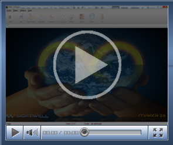

Instalando o Servidor de licenças

Este vídeo demonstra a instalação do Servidor de Licenças

(Duração 01'29", Tamanho 1,0 Mb)

Instalando o Servidor de Relatórios

Este vídeo demonstra a instalação do Servidor de Relatórios

(Duração 01'58", Tamanho 2,0 Mb)

Utilizando o Profile

Este vídeo demonstra a utilização da nova ferramenta do maker o Profiler. O Profiler é um utilitário estatístico utilizado para avaliação das regras utilizadas no sistema a fim de identificar possíveis gargalos e evitar que o produto final chegue até o cliente com pouco desempenho

(Duração 02'41", Tamanho 3,95 Mb)

Utilizando o Debug(depurador)

Este vídeo demonstra a utilização do novo depurador do Maker. O novo Depurador tem como função detectar erros na construção de um fluxograma, rastreando todos os objetos (processamentos, decisões, subfluxos e interações) presentes na regra executada.

(Duração 02'24", Tamanho 3,65 Mb)
