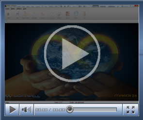

Instalando o Servidor de Licenças

Este vídeo demonstra a instalação do Servidor de Licenças

(Duração 01'29", Tamanho 1,0 Mb)

[Instalando Servidor Biométrico](ftp://ftp.softwell.com.br/videos/instalando_o_servidor_bimetrico.zip)

Este vídeo demonstra como instalar o servidor biométrico.

(Duração 22'', Tamanho 2,12 Mb)
