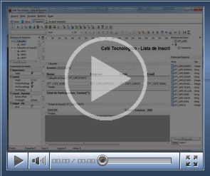
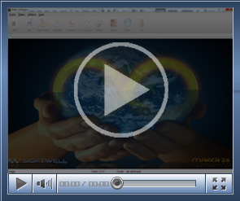

[Abrir relatório imediatamente](ftp://ftp.softwell.com.br/videos/abrir_relatorio_imediatamente.zip)

Este exemplo demonstra a utilização da função Abrir Relatório Imediatamente, personalizando a chamada de relatórios por meio do evento Ao clicar de um botão no formulário.

(Duração 02'40", Tamanho 5,49 Mb)

[Abrir relatório ordenado](ftp://ftp.softwell.com.br/videos/abrir_relatorio_ordenado.zip)

Este exemplo utiliza a função Abrir Relatório ordenado personalizando a ordenação dos dados do relatório, através da interatividade do usuário selecionando o campo e a ordem.

(Duração 03'19', Tamanho 5,28 Mb)

[Alternando de cor dos dados impressos em um relatório](ftp://ftp.softwell.com.br/videos/alternacao_de_cor_dos_ dados_impressos_linhas_em_um_relatorio_ok.zip)

Este vídeo exemplifica como zebrar as linhas dos dados impressos em um relatório.

(Duração 02'04", Tamanho 1,87 Mb)

[Criando Gráfico em um relatório](ftp://ftp.softwell.com.br/videos/grafico_no_relatorio.zip)

Este vídeo demonstra os passos para a criação de gráfico em um relatório.

(Duração 2'14", Tamanho 2,12 Mb)

[Criando relatório com sub-relatório](ftp://ftp.softwell.com.br/videos/relatorio_com_sub_relatorio.zip)

Este vídeo demonstra os passos para criação de relatório com sub-relatório.

(Duração 5'35", Tamanho 2,80 Mb)

[Demonstrando como acessar relatório externo com filtro](ftp://ftp.softwell.com.br/videos/relatorio_externo_com_filtro.zip)

Este vídeo demonstra como o usuário pode acessar um relatório externamente com filtro.

(Duração 1'39",Tamanho 2,31 Mb)

[Demonstrando relatório com referência cruzada](ftp://ftp.softwell.com.br/videos/referencia_cruzada.zip)

Esta videoaula demonstra o uso de referência cruzada em relatório

(Duração 1'21", Tamanho  2,69 Mb)

[Exportando Relatório para JASPER](ftp://ftp.softwell.com.br/videos/exportando_relatorio_para_jasper.zip)

Este vídeo exemplifica a utilização do recurso de exportação individual de relatórios para o formato JASPER.

(Duração 44'', Tamanho 2,98 Mb)

Instalando o Servidor de Relatórios

Este vídeo demonstra a instalação do Servidor de Relatórios

(Duração 01'58", Tamanho 2,0 Mb)

[Relatório](ftp://ftp.softwell.com.br/videos/relatorio.zip)

Este exemplo demonstra a criação de um relatório.

(Duração 1'54'', Tamanho 4,61 Mb)
