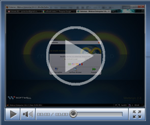

[Acessando e configurando um sistema no browser](ftp://ftp.softwell.com.br/videos/acessando_e_configurando_o_navegador.zip)

Este vídeo demonstra como verificar as configurações do Webrun para conectar com o banco de dados do projeto.

(Duração 40'', Tamanho 4,38 Mb)

[Demonstrando Parâmetros de Configuração](ftp://ftp.softwell.com.br/videos/demonstrando_parametros_de_configuracao.zip)

Este vídeo apresenta as opções básicas sobre os Parâmetros de Configuração do Webrun.

(Duração 2'01'', Tamanho 3,27 Mb)

[Editando projetos e visualizando na web](ftp://ftp.softwell.com.br/videos/editando_projetos_e_visualizando_na_web.zip)

Este vídeo demonstra a capacidade de desenvolvimento e visualização imediata do projeto na Web.

(Duração 53'', Tamanho 3,02 Mb)

[Modo Gerente no Webrun](ftp://ftp.softwell.com.br/videos/modo_gerente_no_webrun.zip)

Esta videoaula exemplifica a utilização do recurso Modo Gerente no ambiente do Webrun. Este recurso faz parte do conjunto de ferramentas disponíveis para o Controle de Acesso ao sistema.

(Duração 57'', Tamanho 4,1 Mb)

[Publicar o Projeto - Gerador.WAR](ftp://ftp.softwell.com.br/videos/publicar_o_projeto_gerando_war.zip)

Este exemplo demonstra como publicar o projeto gerando um arquivo .WAR.

(Duração 1'10'', Tamanho 3,27 Mb)

[Exportando código (JAR)](ftp://ftp.softwell.com.br/videos/exportar_codigo_jar_.zip)

Este vídeo demonstra como exportar o código (JAR).

(Duração 01'09", Tamanho 1,98 Mb).
